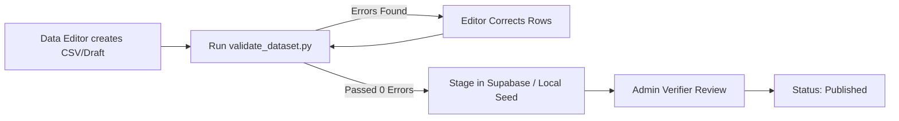

# UniSelection — Data Operations & Verification Guidelines

**Version:** 1.0  
**Scope Reference:** Section 7 & Module 14/15 of `UniSelection_Phase_1_Master_Scope_v1.2.md`

This guide explains the data lifecycle, editorial verification principles, and validation procedures for contributors and data editors.

---

## 1. Editorial Principles

1. **Source Attribution Mandatory:** No institution, programme, fee structure, or deadline may be created without citing a primary official source URL (e.g. university official domain or HEC regulatory portal).
2. **Never Speculate:** If an institution has not announced their Fall 2026 deadline, record the status as `Upcoming` or leave the closing date null with status `Under Review`. Never insert guesswork.
3. **Session Specificity:** Every fee and admission entry must be qualified by an academic session (e.g. `2025–2026`).
4. **Distinguish Currency & Basis:** Fees must specify the billing period (`Per Semester`, `Per Year`, or `Full Programme`) and explicit 3-letter currency code (`PKR`, `USD`, `EUR`, `GBP`).
5. **Caveats on Eligibility:** Guidance tools provide informational checks against published rules; they do not guarantee admission. Every rule must include the standard legal caveat.

---

## 2. Ingestion & Validation Workflow



To run the offline validation tool:
```bash
python data/validation/validate_dataset.py
```
Any malformed URL, missing foreign key, or invalid date format will immediately block ingestion.
