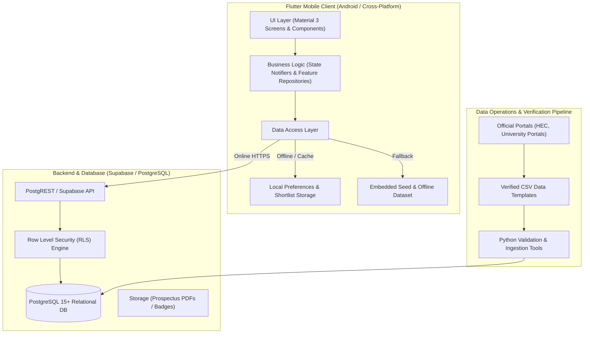

# UniSelection — System Architecture & Technical Design

**Version:** 1.0  
**Status:** Approved Phase 1 Baseline  
**Scope Reference:** Section 12 & Section 13 of `UniSelection_Phase_1_Master_Scope_v1.2.md`

---

## 1. Architecture Overview

UniSelection is designed as an Android-first client application backed by Supabase (PostgreSQL with Row Level Security) and resilient local caching/seed layers.



---

## 2. Technology Stack

| Layer | Component | Version / Description |
|---|---|---|
| **Mobile Client** | Flutter / Dart | Flutter 3.13+ / Dart 3.0+ |
| **Design System** | Material 3 + Custom Tokens | Tailored color scheme (Deep Navy, Slate Blue, Teal Accent), responsive typography |
| **State Management** | ChangeNotifier / Repository Pattern | Clean separation of concerns without heavyweight boilerplate |
| **Local Storage** | Shared Preferences / Local JSON | Persistent shortlist and user preferences for guest browsing |
| **Backend** | Supabase / PostgreSQL | Managed PostgreSQL 15+ with native PostgREST |
| **Security** | Row Level Security (RLS) | Granular read/write policies based on user auth role |
| **Data Validation** | Python 3.10+ | Strict batch import verification, FK checks, and URL validations |

---

## 3. Client Architecture (Feature-First)

The Flutter mobile client follows a clean **feature-first structure**:
```text
lib/
├── app/
│   ├── app.dart              # MaterialApp configuration & routing
│   ├── routes.dart           # App navigation routes
│   └── theme.dart            # Material 3 theme & typography tokens
├── core/
│   ├── constants/            # App constants, strings, asset paths
│   ├── models/               # Domain models (Institution, Programme, Fee, etc.)
│   ├── services/             # Storage service, validation service, connectivity
│   └── repositories/         # Unified repository (Remote Supabase + Local Seed fallback)
└── features/
    ├── onboarding/           # Welcome, National vs International selector
    ├── home/                 # Discovery hub, categories, featured institutions
    ├── institutions/         # Institution listing, details, campus views
    ├── programmes/           # Programme catalogue, detail views, requirements
    ├── search/               # Multi-facet search and filter modal
    ├── eligibility/          # Rule-based eligibility checker with caveats
    ├── admissions/           # Admission deadlines, cycle tracking, calendar
    ├── fees/                 # Transparent fee schedules & financial breakdown
    ├── shortlist/            # Saved institutions and programmes
    ├── comparison/           # Side-by-side comparison matrix
    ├── profile/              # Student preferences (degree level, disciplines)
    ├── settings/             # About, privacy policy, disclaimer, sources policy
    └── admin/                # Verification review queue and CSV validation preview
```

---

## 4. Data Layer & Resilient Dual-Mode Operation

To satisfy **Sprint 0 & Sprint 1 requirements** and ensure flawless offline testing:
1. **Remote Provider**: Communicates with Supabase using HTTPS REST endpoints.
2. **Local Seed Provider**: Bundles verified reference data directly inside the client application so discovery, search, eligibility checking, and comparison work without requiring live network access or database provisioning on every development machine.
3. **Repository Interceptor**: If the Supabase client is configured and reachable, live verified data is retrieved. Otherwise, it gracefully falls back to the embedded verified dataset.

---

## 5. Security & Privacy Architecture

1. **Deny-by-Default RLS**: All tables in PostgreSQL require explicit `GRANT` and policy rules.
2. **Anonymous Read**: Public visitors have `SELECT` access only to published records (`status = 'published'`).
3. **Owner-Only Personal Data**: User profiles and saved items can only be queried or mutated by the owning authenticated `auth.uid()`.
4. **No Secrets in Client**: The client application only carries the Supabase URL and public anonymous key (`anon_key`). Service-role keys are strictly prohibited from client code and repositories.
5. **Data Minimization**: No CNIC, passport numbers, or financial bank statements are collected in Phase 1.
