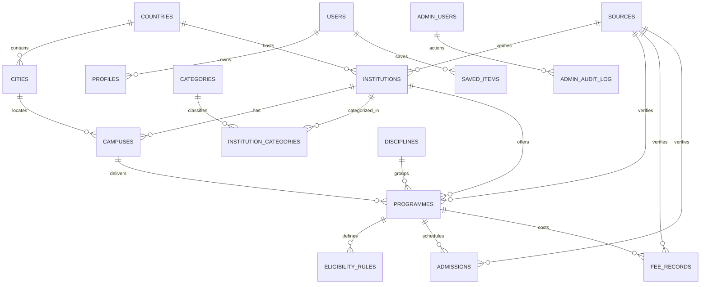

# UniSelection — Data Dictionary & Entity Relationship Specification

**Version:** 1.0  
**Scope Reference:** Section 8 of `UniSelection_Phase_1_Master_Scope_v1.2.md`

This document specifies the normalized relational database entities, primary keys, foreign keys, data types, constraints, and descriptions used across PostgreSQL and the Flutter application.

---

## 1. Entities Overview

---

## 2. Table Specifications

### 2.1 `countries`
Stores ISO-standard countries supported in the platform.
| Column | Type | Constraints | Description |
|---|---|---|---|
| `id` | `VARCHAR(3)` | PRIMARY KEY | ISO 3166-1 alpha-3 code (e.g. `PAK`, `GBR`, `USA`) |
| `name` | `VARCHAR(100)` | NOT NULL, UNIQUE | Country common name |
| `is_national` | `BOOLEAN` | DEFAULT FALSE | TRUE if country is Pakistan (National scope) |
| `created_at` | `TIMESTAMPTZ` | DEFAULT now() | Record creation timestamp |

### 2.2 `cities`
Cities and metropolitan regions within countries.
| Column | Type | Constraints | Description |
|---|---|---|---|
| `id` | `UUID` | PRIMARY KEY | Unique identifier |
| `country_id` | `VARCHAR(3)` | NOT NULL, FK -> countries(id) | Associated country |
| `name` | `VARCHAR(100)` | NOT NULL | City name (e.g. Islamabad, Lahore, Karachi) |
| `province_state`| `VARCHAR(100)` | NULL | Province or administrative region |
| `created_at` | `TIMESTAMPTZ` | DEFAULT now() | Record creation timestamp |

### 2.3 `categories`
Data-driven academic classification categories (e.g. Engineering, Computing & IT, Medical & Health Sciences, Business & Management).
| Column | Type | Constraints | Description |
|---|---|---|---|
| `id` | `UUID` | PRIMARY KEY | Unique identifier |
| `slug` | `VARCHAR(50)` | NOT NULL, UNIQUE | URL-safe slug (e.g. `engineering`, `computing-it`) |
| `name` | `VARCHAR(100)` | NOT NULL | Display name |
| `description` | `TEXT` | NULL | Scope of the category |
| `icon_name` | `VARCHAR(50)` | NULL | Material Icon key for mobile UI rendering |

### 2.4 `institutions`
University and degree-awarding institutions.
| Column | Type | Constraints | Description |
|---|---|---|---|
| `id` | `VARCHAR(50)` | PRIMARY KEY | Canonical slug ID (e.g. `nust`, `lums`, `oxford`) |
| `name` | `VARCHAR(255)` | NOT NULL | Official full name |
| `short_name` | `VARCHAR(50)` | NULL | Acronym or popular abbreviation (e.g. `NUST`) |
| `country_id` | `VARCHAR(3)` | NOT NULL, FK -> countries(id) | Country code |
| `city_id` | `UUID` | NULL, FK -> cities(id) | Primary headquarter city |
| `institution_type`| `VARCHAR(30)` | CHECK in ('Public', 'Private', 'Autonomous') | Sector / governance |
| `hec_recognized` | `BOOLEAN` | DEFAULT TRUE | Verified status against HEC register |
| `official_website`| `TEXT` | NOT NULL | Primary official university website |
| `admissions_url` | `TEXT` | NULL | Direct link to official admissions portal |
| `contact_email` | `VARCHAR(150)` | NULL | Official inquiry email |
| `contact_phone` | `VARCHAR(50)` | NULL | Official admissions office phone |
| `logo_url` | `TEXT` | NULL | Verified badge / emblem image path |
| `overview` | `TEXT` | NULL | Factual summary derived from official website |
| `status` | `VARCHAR(20)` | DEFAULT 'draft' CHECK in ('draft','in_review','published','archived') | Editorial state |
| `source_id` | `UUID` | NULL, FK -> sources(id) | Reference to verification source |
| `last_verified_at`| `DATE` | NOT NULL | Date data was last audited by editor |
| `created_at` | `TIMESTAMPTZ` | DEFAULT now() | Record creation timestamp |

### 2.5 `institution_categories`
Many-to-many junction allowing institutions to belong to multiple categories.
| Column | Type | Constraints | Description |
|---|---|---|---|
| `institution_id` | `VARCHAR(50)` | NOT NULL, FK -> institutions(id) ON DELETE CASCADE | Institution |
| `category_id` | `UUID` | NOT NULL, FK -> categories(id) ON DELETE CASCADE | Category |
| PRIMARY KEY (`institution_id`, `category_id`) | | | Composite primary key |

### 2.6 `campuses`
Recognized sub-campuses or regional campuses of an institution.
| Column | Type | Constraints | Description |
|---|---|---|---|
| `id` | `UUID` | PRIMARY KEY | Campus unique ID |
| `institution_id` | `VARCHAR(50)` | NOT NULL, FK -> institutions(id) | Parent institution |
| `name` | `VARCHAR(150)` | NOT NULL | Campus designation (e.g. `H-12 Main Campus`, `Rawalpindi Campus`) |
| `city_id` | `UUID` | NOT NULL, FK -> cities(id) | Location city |
| `address` | `TEXT` | NULL | Physical verified address |
| `is_main_campus` | `BOOLEAN` | DEFAULT FALSE | Flag for central campus |
| `hec_recognized` | `BOOLEAN` | DEFAULT TRUE | Validated against HEC recognized campuses list |
| `official_url` | `TEXT` | NULL | Official webpage for campus |
| `status` | `VARCHAR(20)` | DEFAULT 'published' | Editorial status |

### 2.7 `disciplines`
Academic disciplines under which programmes are grouped.
| Column | Type | Constraints | Description |
|---|---|---|---|
| `id` | `UUID` | PRIMARY KEY | Unique identifier |
| `category_id` | `UUID` | NOT NULL, FK -> categories(id) | Associated category |
| `name` | `VARCHAR(100)` | NOT NULL | Discipline name (e.g. `Software Engineering`, `Medicine (MBBS)`) |

### 2.8 `programmes`
Undergraduate and graduate degree programmes offered by institutions.
| Column | Type | Constraints | Description |
|---|---|---|---|
| `id` | `UUID` | PRIMARY KEY | Programme unique ID |
| `institution_id` | `VARCHAR(50)` | NOT NULL, FK -> institutions(id) | Offering institution |
| `campus_id` | `UUID` | NULL, FK -> campuses(id) | Offering campus (optional if multi-campus) |
| `name` | `VARCHAR(200)` | NOT NULL | Degree title (e.g. `BS Computer Science`) |
| `degree_level` | `VARCHAR(30)` | CHECK in ('Undergraduate', 'Postgraduate', 'Doctorate', 'Associate') | Level of study |
| `discipline_id` | `UUID` | NOT NULL, FK -> disciplines(id) | Academic discipline |
| `duration_years` | `NUMERIC(3,1)` | CHECK (duration_years > 0) | Normal completion duration in years |
| `study_mode` | `VARCHAR(30)` | DEFAULT 'Full-Time' | Full-Time, Part-Time, Hybrid |
| `official_url` | `TEXT` | NOT NULL | Official prospectus / programme page |
| `status` | `VARCHAR(20)` | DEFAULT 'published' | Editorial publication status |
| `last_verified_at`| `DATE` | NOT NULL | Date verified |

### 2.9 `eligibility_rules`
Explicit, institution-published qualification requirements.
| Column | Type | Constraints | Description |
|---|---|---|---|
| `id` | `UUID` | PRIMARY KEY | Rule ID |
| `programme_id` | `UUID` | NOT NULL, FK -> programmes(id) ON DELETE CASCADE | Associated programme |
| `rule_type` | `VARCHAR(50)` | NOT NULL | (e.g. `min_percentage`, `subject_prerequisite`, `entry_test`) |
| `min_percentage` | `NUMERIC(5,2)` | NULL | Minimum required score percentage (e.g. `60.00`) |
| `required_subjects`| `TEXT` | NULL | Comma-separated or text criteria (e.g. `Physics, Mathematics`) |
| `accepted_entry_tests`| `TEXT` | NULL | Test names (e.g. `NET, SAT-I, NTS NAT-IE`) |
| `rule_explanation`| `TEXT` | NOT NULL | Plain-English summary of the published rule |
| `caveat` | `TEXT` | NOT NULL | Mandatory legal caveat regarding merit weighting |
| `effective_session`| `VARCHAR(20)` | NOT NULL | Academic year (e.g. `2025-2026`) |
| `source_url` | `TEXT` | NOT NULL | Direct link to official admission criteria |
| `last_verified_at`| `DATE` | NOT NULL | Audit date |

### 2.10 `admissions`
Admissions sessions, intakes, and key published deadlines.
| Column | Type | Constraints | Description |
|---|---|---|---|
| `id` | `UUID` | PRIMARY KEY | Session ID |
| `institution_id` | `VARCHAR(50)` | NOT NULL, FK -> institutions(id) | Institution |
| `programme_id` | `UUID` | NULL, FK -> programmes(id) | Specific programme (or NULL for uni-wide) |
| `session_name` | `VARCHAR(50)` | NOT NULL | e.g. `Fall 2025`, `Spring 2026` |
| `opening_date` | `DATE` | NULL | Application open date |
| `closing_date` | `DATE` | NULL | Application deadline |
| `entry_test_date`| `DATE` | NULL | Scheduled test date |
| `admission_status`| `VARCHAR(30)` | CHECK in ('Upcoming', 'Open', 'Closed', 'Under Review') | Current status |
| `source_url` | `TEXT` | NOT NULL | Official source schedule URL |
| `last_verified_at`| `DATE` | NOT NULL | Verification timestamp |

### 2.11 `fee_records`
Tuition, recurring charges, and one-time fees.
| Column | Type | Constraints | Description |
|---|---|---|---|
| `id` | `UUID` | PRIMARY KEY | Fee record ID |
| `programme_id` | `UUID` | NOT NULL, FK -> programmes(id) | Associated programme |
| `academic_session`| `VARCHAR(20)` | NOT NULL | e.g. `2025-2026` |
| `currency` | `VARCHAR(3)` | NOT NULL | e.g. `PKR`, `GBP`, `USD` |
| `billing_basis` | `VARCHAR(30)` | CHECK in ('Per Semester', 'Per Year', 'Per Credit Hour', 'Full Programme') | Billing frequency |
| `tuition_fee` | `NUMERIC(12,2)`| NOT NULL | Tuition amount per billing period |
| `admission_fee_onetime`| `NUMERIC(12,2)`| DEFAULT 0 | One-time registration / admission fee |
| `security_deposit`| `NUMERIC(12,2)`| DEFAULT 0 | Refundable deposit |
| `notes` | `TEXT` | NULL | Specific conditions, tax notes, lab dues |
| `source_url` | `TEXT` | NOT NULL | Official fee prospectus link |
| `last_verified_at`| `DATE` | NOT NULL | Verification date |

### 2.12 `sources` & `verification_records`
Audit trail of public sources and review decisions.
| Column | Type | Constraints | Description |
|---|---|---|---|
| `id` | `UUID` | PRIMARY KEY | Source unique ID |
| `title` | `VARCHAR(255)` | NOT NULL | Official publication title |
| `provider` | `VARCHAR(150)` | NOT NULL | Publishing authority (e.g. `HEC Pakistan`, `NUST Admissions Office`) |
| `url` | `TEXT` | NOT NULL | Canonical webpage URL |
| `source_type` | `VARCHAR(50)` | CHECK in ('Regulator', 'Official Portal', 'Prospectus PDF', 'Direct Confirmation') | Category |
| `accessed_at` | `TIMESTAMPTZ` | NOT NULL | Date accessed |
| `editor_id` | `VARCHAR(100)` | NOT NULL | Reviewing editor identification |
| `notes` | `TEXT` | NULL | Additional notes or archiving reference |
