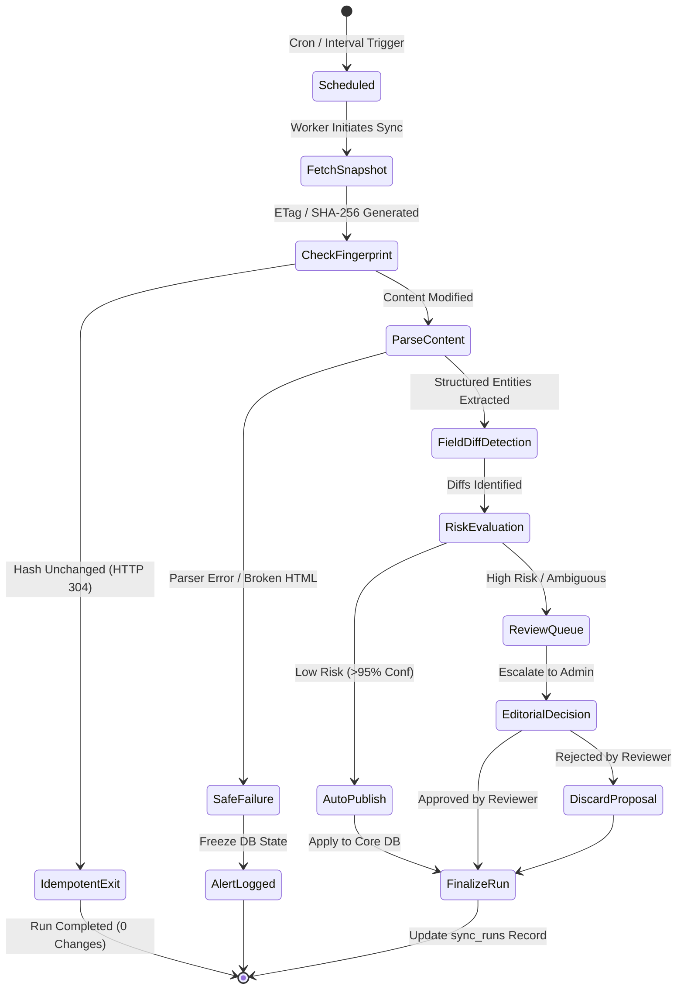

# UniSelection — Global Data Synchronization & Change Detection Design

**Version:** 1.0  
**Effective Date:** 17 October 2026  
**Scope Reference:** Section 7 & Section 8 of `UniSelection_Phase_1_Master_Scope_v1.3.md`

---

## 1. Synchronization Lifecycle & State Machine

UniSelection implements a stateful synchronization lifecycle ensuring that incoming data from diverse web endpoints is validated, diffed, risk-assessed, and stored without data corruption or noisy duplicates.

---

## 2. Multi-Level Change Detection Mechanics

UniSelection distinguishes between superficial web page updates and meaningful university facts through a 3-tier detection filter:

### Level 1: Network-Level Fingerprinting
- **Conditional Headers:** Requests transmit `If-None-Match: "<etag>"` and `If-Modified-Since: "<timestamp>"`.
- If the server responds with `HTTP 304 Not Modified`, execution terminates immediately.
- If `HTTP 200` is returned, a cryptographic SHA-256 hash of the response body is computed:
  $$\text{content\_hash} = \text{SHA-256}(\text{raw\_response\_bytes})$$
- If $\text{content\_hash} == \text{previous\_content\_hash}$, the synchronization run is marked complete with `0` records modified (Idempotency Gate).

### Level 2: Structural DOM / JSON Diff
- For HTML sources, boilerplate navigation menus, footers, timestamp banners, and tracking scripts are stripped before comparison.
- Structured JSON or normalized records are extracted and compared against the current database representation.

### Level 3: Granular Field-Level Diffs
- Diffs are evaluated on an entity-field basis:
  $$\Delta = \{\text{entity\_type}, \text{entity\_id}, \text{field\_name}, \text{old\_value}, \text{new\_value}\}$$
- If $\text{old\_value} == \text{new\_value}$ after normalization (trimming whitespace, case normalization, date standardization), no event is generated.

---

## 3. Risk-Based Publication Matrix

Not all data updates are treated equally. High-impact shifts undergo mandatory human review:

| Fact Type | Change Trigger | Risk Level | Action Taken | Rationale |
|---|---|---|---|---|
| **Accreditation Status** | `hec_recognized` toggles; accreditation body alters | 🔴 **Critical** | Route to `review_queue` (Immediate Admin Alert) | Severe legal and educational impact on students. |
| **Admission Deadline** | Application closing date shifts forward or backward | 🟠 **High** | Route to `review_queue` | Students risk missing admission cutoff dates. |
| **Minimum Academic Eligibility** | Required percentage changes (e.g. 60% $\rightarrow$ 65%) | 🟠 **High** | Route to `review_queue` | Affects student eligibility guidance calculations. |
| **Tuition Fee Increase** | Published fee shifts by $>10\%$ | 🟠 **High** | Route to `review_queue` | Significant financial consequence for applicants. |
| **Tuition Fee Normal Update** | Minor adjustment ($\le 10\%$) in new academic session | 🟡 **Medium** | Auto-publish if source is Tier 1/2 with verified URL | Routine annual indexation. |
| **Official Website URL** | Protocol upgrade (`http` $\rightarrow$ `https`) or domain redirect | 🟢 **Low** | Auto-publish ($>98\%$ confidence) | Low-risk navigation fix. |
| **Name Spelling / Acronym** | Typo correction or normalized alias addition | 🟢 **Low** | Auto-publish ($>95\%$ confidence) | Non-destructive discovery aid. |
| **New Degree Programme** | New programme detected on verified portal | 🟡 **Medium** | Auto-publish with status `'in_review'` | Increases catalog breadth safely. |

---

## 4. Idempotency Guarantees & Verification Proof

UniSelection guarantees that repeated synchronization runs over an unchanging dataset produce:
1. Zero duplicate rows inserted into `institutions`, `campuses`, `programmes`, `admissions`, or `fee_records`.
2. Zero new rows added to `source_change_events`.
3. An audit record in `sync_runs` showing `records_updated: 0` and `status: 'completed'`.

### Idempotency Enforcement Mechanism
- Database tables enforce unique constraints:
  - `institutions(id)`
  - `institution_identifiers(institution_id, id_type, id_value)`
  - `institution_aliases(institution_id, alias_name)`
  - `programmes(institution_id, name, degree_level)`
- Python ingestion upsert logic uses `ON CONFLICT (id) DO UPDATE` with conditional `WHERE` clauses that update timestamps only if data values genuinely diverge.

---

## 5. Safe Failure & Circuit Breakers

When target endpoints experience instability or format changes, UniSelection isolates the failure to protect the active catalogue:

1. **HTTP 404 / 500 Outages:**
   - The connector logs a failure in `sync_runs` with the error message and status code.
   - **Zero existing records are deleted or marked inactive** based on a single failed fetch.
   - A threshold counter (`consecutive_failures`) increments. If $\ge 5$ consecutive failures occur over 14 days, the source is flagged as `unreachable` for human investigation.
2. **Parser Layout Drift:**
   - If an HTML scraper expects an element (e.g. `table.admissions-table`) that returns empty while the HTTP response is 200 OK:
   - The parser raises `FormatDriftException`.
   - The sync run aborts immediately before any records are cleared.
   - Connector status updates to `'format_drift'` in `source_connectors`.
3. **HTTP 429 Rate Limiting:**
   - Ingestion halts immediately on that host.
   - The thread sleeps for the duration indicated in `Retry-After` (or default 60s).

---

## 6. Scheduling Cadence

Synchronization jobs are scheduled according to entity volatility:

| Entity Scope | Frequency | Execution Window | Target Sources |
|---|---|---|---|
| **Admission Deadlines & Active Cycles** | Daily (Every 24h) | 02:00 UTC | Tier 2 Official Admissions Portals |
| **Fee Structures & Scholarships** | Weekly (Every 7d) | Sunday 04:00 UTC | Tier 2 Official Prospectuses |
| **Institutional Catalogues & Programmes** | Bi-weekly (Every 14d) | 1st & 15th of month | Tier 1 HEC Recognized Portals |
| **Global Institutional Metadata & Identifiers** | Monthly (Every 30d) | 1st of month | Tier 3 ROR API, OpenAlex API |
| **Regulatory Warnings & Accreditation Notices** | Daily Priority Check | 06:00 UTC | Tier 1 HEC Statutory Gazettes |
