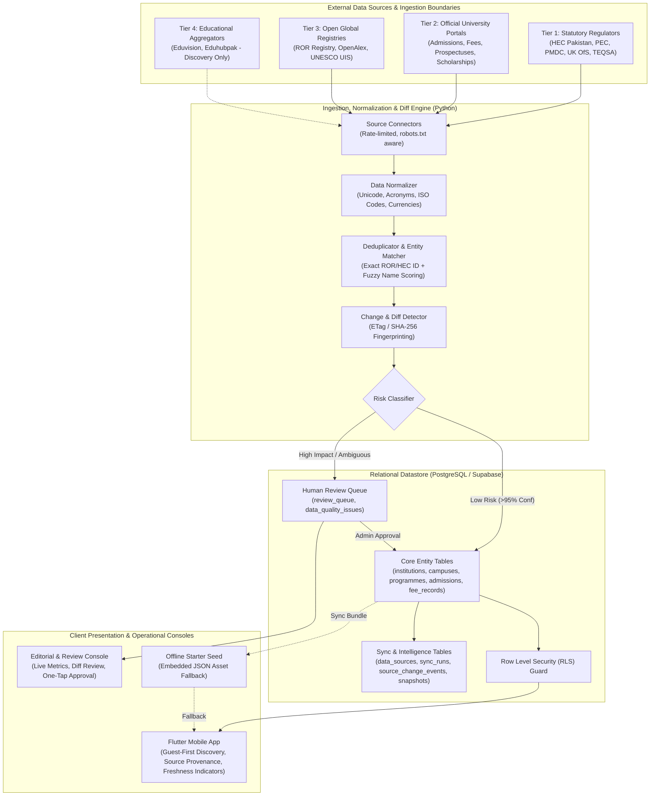
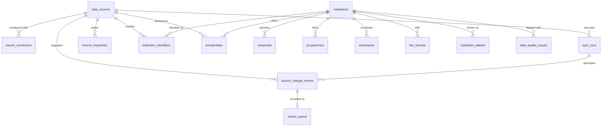

# UniSelection — Global University Data Intelligence Architecture

**Version:** 1.0  
**Effective Date:** 17 October 2026  
**Scope Reference:** Section 8 & Section 9 of `UniSelection_Phase_1_Master_Scope_v1.3.md`

---

## 1. Architectural Overview & System Topography

UniSelection's data architecture is designed for high reliability, verifiable provenance, and automated synchronization. The platform bridges statutory government regulators, international open registries, and official university portals into a normalized, query-optimized relational datastore consumed by the Flutter mobile client and the editorial console.

---

## 2. Multi-Layer Ingestion Strategy

To ensure broad coverage while preserving data integrity, ingestion operates in three decoupled tiers:

### Layer A: Global Institutional Discovery
- **Objective:** Broad institutional registry covering thousands of accredited universities across 50+ countries.
- **Sources:** Research Organization Registry (ROR v2 API) and OpenAlex Institutions API.
- **Filters:** Strictly filters for organizations where `types = ["Education"]` or `institution_type = "university"`. Non-degree awarding research laboratories, pharmaceutical companies, hospitals, and government agencies are excluded.
- **Attributes Ingested:** Canonical Legal Name, Acronyms, Country Code (ISO-3166-1 alpha-3), City, Geocoordinates, Official Homepage URL, ROR ID, OpenAlex ID.

### Layer B: Pakistani National HEC Baseline
- **Objective:** Comprehensive, authoritative coverage of 100% of Pakistani universities, Degree Awarding Institutions (DAIs), and recognized regional sub-campuses.
- **Sources:** Higher Education Commission (HEC Pakistan) recognized university list and recognized sub-campus registry.
- **Attributes Ingested:** Full Legal Name, Sector (Public vs Private), Chartering Body (e.g. Government of Pakistan, Government of Punjab), Regional Province, Main Campus Location, Recognized Sub-Campuses, Official Portal, HEC Recognized status (`true`), Accreditation Body (`"HEC"`).

### Layer C: Institution-Specific Detailed Records
- **Objective:** Ingest time-sensitive, actionable academic facts for target universities.
- **Sources:** Official university websites, published fee schedules, and admission notices.
- **Attributes Ingested:**
  - *Programmes:* Degree level, title, discipline mapping, credit hours, duration.
  - *Admissions:* Intake cycle (e.g. "Fall 2026"), application open date, application close date, entry test schedule.
  - *Fees:* Tuition amount, currency, billing basis (`per_semester`, `per_year`), academic session.
  - *Scholarships:* Award title, provider, funding type (`fully_funded`, `partial_tuition`), eligibility criteria, application deadline.
  - *Eligibility:* Minimum percentage threshold, required prerequisite qualifications, official admissions URL.

---

## 3. Entity-Relationship Model & Schema Enhancements

Migration `003_global_intelligence_and_sync.sql` establishes 11 new relational tables:

### Table Dictionary Summary
1. `data_sources`: Master catalog of sources, authority tiers, refresh frequencies, and access terms.
2. `source_connectors`: Endpoint configuration, rate limits (RPS), timeouts, and HTTP headers.
3. `source_field_mappings`: Granular rules mapping which source has primary authority for each field.
4. `sync_runs`: Audit history of crawler/sync executions, runtime durations, and record counts.
5. `source_snapshots`: Content fingerprints (ETags, Last-Modified dates, SHA-256 hashes).
6. `source_change_events`: Field-level diffs (`old_value` vs `proposed_new_value`) with confidence ratings.
7. `review_queue`: Workflow for high-impact mutations awaiting editorial approval.
8. `institution_identifiers`: Cross-namespace external keys (ROR, OpenAlex, HEC DAI ID, CRICOS, UKPRN).
9. `institution_aliases`: Historical names, acronyms, and multilingual transliterations.
10. `scholarships`: Structured financial aid opportunities with deadlines and eligibility criteria.
11. `data_quality_issues`: Discrepancy log for broken URLs, stale records, and conflicting claims.

---

## 4. Identity Resolution & Deduplication Logic

Universities often appear across different sources with subtle variations in naming (e.g. `"NUST"`, `"National University of Sciences & Technology"`, `"National University of Sciences and Technology (NUST), Islamabad"`).

UniSelection executes a 3-step deterministic matching pipeline:
1. **Exact Persistent Identifier Match:** If an incoming record shares a verified `ROR ID`, `OpenAlex ID`, or `HEC DAI ID` with an existing institution, it is linked automatically with 100% confidence.
2. **Normalized Domain Match:** If the official website hostname matches (e.g. `nust.edu.pk` == `www.nust.edu.pk`), the entity is resolved with 98% confidence.
3. **Fuzzy String Scoring & Alias Index:** Normalized token sort ratio (Levenshtein distance) is calculated against canonical names and aliases:
   - Score $\ge 0.95$ and matching country/city: Auto-linked.
   - Score $0.80 - 0.94$: Candidate duplicate created; routed to `review_queue` for manual confirmation.
   - Score $< 0.80$: Treated as a distinct new institution.

---

## 5. Security Architecture & RLS Enforcement

- **Client Key Isolation:** Flutter mobile app uses only the public anonymous key (`SUPABASE_ANON_KEY`). Service-role credentials (`SUPABASE_SERVICE_ROLE_KEY`) are restricted strictly to server-side ingestion scripts and CI runners.
- **Row Level Security (RLS):**
  - Public anonymous users possess **read-only** access to records where `status = 'published'` and `is_active = true`.
  - Anonymous users are blocked with `USING (FALSE)` from inserting, updating, or deleting any data sources, sync runs, review queue items, or institutions.
  - Data editors authenticate via Supabase Auth; review queue mutations are restricted to users with `role = 'admin'` or `'editor'`.
